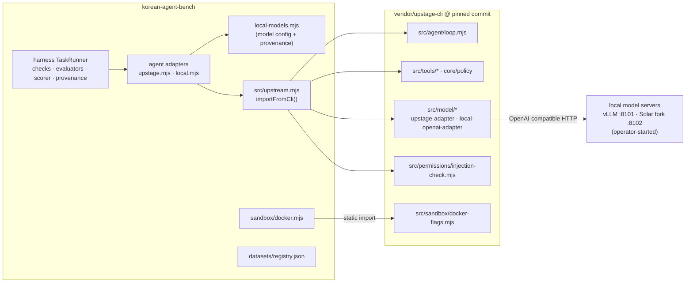
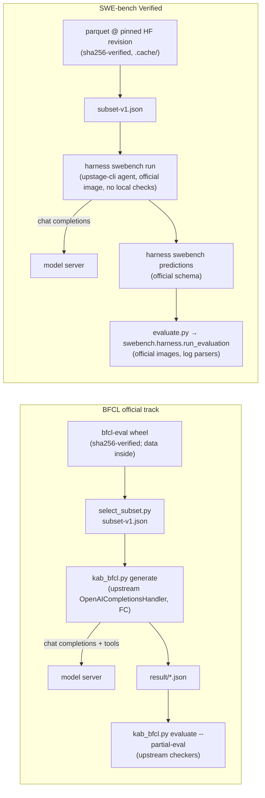

# Architecture

The current-state map of the repository. For *why* it is shaped this way see
the ADRs in [`adr/`](adr/); for the dated history of how the harness was
built and verified, see [`research/README.md`](research/README.md).

## Layout

```
korean-agent-bench/
├── harness/                 evaluation harness (Node, ESM) — migrated with history
│   ├── src/upstream.mjs     the ONLY locator for upstage-cli (ADR 0002)
│   ├── src/agent/           adapters (mock, upstage, local, claude-code, aider, opencode),
│   │                        local-models.mjs (four-model registry), tool policy, sandboxed tools
│   ├── src/task/            task schema, loader, runner (provenance), SWE-bench/Aider importers
│   ├── src/sandbox/         native + Docker sandboxes, trusted read-only mount registry
│   ├── src/evaluation/      checks, trusted evaluators, scorer, pass@k, failure taxonomy
│   ├── src/benchmark/       benchmark-v1 manifest, fixture QA
│   ├── src/benchmarks/      SWE-bench Verified prediction generation (no scoring)
│   ├── src/preflight/       serving preflight: declared vs observed (ADR 0008)
│   ├── tasks/ fixtures/     synthetic regression fixtures (datasets/registry.json)
│   ├── benchmarks/v1/       benchmark-v1 manifest + reference solutions
│   ├── docs/                harness docs and research reports (history preserved)
│   └── tests/               h1–h29 (unit tier + Docker tier)
├── vendor/upstage-cli/      git submodule, pinned — the agent under test
├── benchmarks/              official-tooling integration: setup.sh, bfcl/, swebench/ (ADR 0009)
├── datasets/                registry.json (ADR 0003); bfcl/ and swe-bench-verified/ subsets, index, feasibility
├── models/serving/          maintained launchers (ADR 0008)
├── models/serving-records/  model-serving evidence, verbatim + SHA256SUMS (ADR 0005)
├── results/                 run records and validation evidence, verbatim + SHA256SUMS (ADR 0005)
├── scripts/                 check-evidence.sh (disclosure guard)
└── docs/                    STATUS, ARCHITECTURE, MIGRATION, VERIFY, adr/, audits/, models/, protocol/, research/
```

## Dependency boundary



What crosses the boundary, exhaustively (enforced by `tests/h24`):

| Harness file | upstage-cli module(s) | How |
|---|---|---|
| `src/agent/adapters/upstage.mjs` | `tools/create-registry.mjs`, `core/policy/engine.mjs`, `agent/loop.mjs`, `model/upstage-adapter.mjs`, `runtime/session.mjs`, `config/defaults.mjs` | `importFromCli` |
| `src/agent/adapters/local.mjs` | `agent/loop.mjs`, `model/local-openai-adapter.mjs`, `runtime/session.mjs`, `config/defaults.mjs` | `importFromCli` |
| `src/safety/guardrails.mjs` | `permissions/injection-check.mjs` | `importFromCli` |
| `src/sandbox/docker.mjs` | `sandbox/docker-flags.mjs` | static import |
| `src/task/runner.mjs` | (git metadata of the submodule only) | `CLI_ROOT` |
| tests h11, h12, h13, h14, h16 | tool registry/builtins, agent loop, session, defaults, local adapter | static imports |

Nothing in upstage-cli imports the harness.

## Run data flow

1. `harness run <task.yaml> --agent <id>` loads and validates the task
   (`task/loader.mjs`, `task/schema.mjs`), resolving read-only mounts by name
   from the trusted registry only.
2. `TaskRunner` copies the fixture into a fresh workspace (never reference
   solutions), selects the sandbox (native or Docker, fail-closed), and runs
   the agent adapter.
3. The adapter builds upstage-cli's real tool registry, confined to the
   workspace and the task's tool policy, and drives upstage-cli's agent loop
   with the model client (Upstage API or a local OpenAI-compatible server).
4. Trusted paths are restored, checks and trusted evaluators run, and the
   scorer produces the outcome. Infrastructure errors become
   `status=error`, never pass/fail.
5. The run record is written with `provenance`: harness commit and
   dirtiness, upstage-cli checked-out and pinned commits (`upstageCli`),
   task spec hash, repo commits, agent, model configuration as declared in
   `local-models.mjs`, limits, tools, environment image.

## External benchmark data flow (ADR 0009)



BFCL generation never involves upstage-cli; SWE-bench generation always does.
Scoring is upstream code in both. Preflight (`harness preflight`) precedes any
live run of either.

## Where things are decided

| Concern | Lives in |
|---|---|
| Which models, revisions, sampling, endpoints | `harness/src/agent/local-models.mjs` |
| How a model is served | `models/serving-records/kserve*.sh` (operator) |
| What a task set may be used for | `datasets/registry.json` |
| How an agent behaves (loop, tools, prompts) | `vendor/upstage-cli` at its pin |
| How a run is conducted and reported | `docs/protocol/EXPERIMENT_PROTOCOL.md` |
| External benchmark versions, subsets, licenses | `datasets/registry.json`, `datasets/*/subset-v1.json` |
| How external benchmarks are run and scored | `benchmarks/README.md`, ADR 0009 |
| Whether the live server matches the declaration | `harness preflight` (ADR 0008) |
